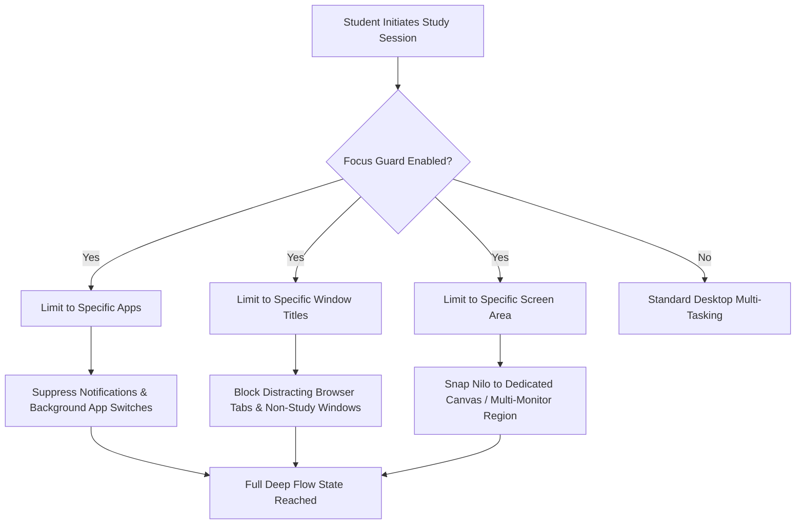

# 🌌 NILO — The Agentic Operating System for Personalized Learning
> **An autonomous, multi-modal desktop environment engineered to unlock deep mastery through Socratic dialogue, voice evaluation, live virtual simulations, and distraction-free cognitive focus.**

[](https://react.dev/)
[](https://www.typescriptlang.org/)
[](https://vitejs.dev/)
[](https://tailwindcss.com/)
[](https://opensource.org/licenses/MIT)

---

## 📑 Table of Contents
1. [The Vision: Why an Agentic Learning OS?](#-the-vision-why-an-agentic-learning-os)
2. [Architectural Blueprint of the OS](#-architectural-blueprint-of-the-os)
3. [The Core Mascot: The Living EXO Orb](#-the-core-mascot-the-living-exo-orb)
4. [Modular Learning Services (The 6 Pillars)](#-modular-learning-services-the-6-pillars)
   - [Pillar 1: Socratic Chat Partner](#1-socratic-chat-partner-chat)
   - [Pillar 2: Conversational Feynman Voice Agent](#2-conversational-feynman-voice-agent-voice)
   - [Pillar 3: Digital Lab & Interactive Simulations](#3-digital-lab--interactive-simulations-digitallab)
   - [Pillar 4: Scratchpad (Scribble Math Canvas)](#4-scratchpad-scribble-math-canvas-scratchpad)
   - [Pillar 5: Concept Games Arcade](#5-concept-games-arcade-games)
   - [Pillar 6: Books & 3D Interactive Library](#6-books--3d-interactive-library-resources)
5. [System-Level Controls & Distraction Blocker (Focus Guard)](#-system-level-controls--distraction-blocker-focus-guard)
6. [Universal Accessibility & Neurodivergent Adaptation](#-universal-accessibility--neurodivergent-adaptation)
7. [How Nilo Ensures Personalized Learning for Every Student](#-how-nilo-ensures-personalized-learning-for-every-student)
8. [Codebase Organization & File System Hierarchy](#-codebase-organization--file-system-hierarchy)
9. [Getting Started & Local Development](#-getting-started--local-development)
10. [Roadmap: From Prototype to Native Agentic OS Kernel](#-roadmap-from-prototype-to-native-agentic-os-kernel)

---

## 💡 The Vision: Why an Agentic Learning OS?

Traditional learning tools are fragmented web pages: static flashcards, passive video feeds, and text-dump chatbots that provide ready-made answers without stimulating original thought.

**Nilo is fundamentally different.** It is designed as an **Agentic Operating System (Agentic OS)**:
- **Autonomous & Proactive**: An environment where the AI companion doesn't just wait for prompts, but actively diagnoses understanding, spots hidden knowledge gaps, and dynamically orchestrates personalized remedial micro-lessons.
- **Feynman-First Philosophy**: Grounded in the principle that *“If you cannot explain it simply, you do not understand it well enough.”* Nilo requires students to verbalize concepts, sketch derivations, and experiment in simulations to prove true cognitive mastery.
- **Unified Workspace Experience**: By embedding navigation into an ergonomic 8-way radial bloom menu, integrating task switching across 10 dynamically updated service sessions, and establishing system-level distraction boundaries, Nilo turns the user's computer into a dedicated, calm, flow-state learning terminal.

```
                      ┌──────────────────────────────────────────────┐
                      │             NILO AGENTIC OS KERNEL           │
                      └──────────────────────┬───────────────────────┘
                                             │
      ┌──────────────────────┬───────────────┴──────────────┬──────────────────────┐
      ▼                      ▼                              ▼                      ▼
┌─────────────┐     ┌──────────────────┐           ┌──────────────────┐     ┌─────────────┐
│ Socratic    │     │ Feynman Oral     │           │ Digital Lab      │     │ Scribble    │
│ Chat Engine │     │ Voice Evaluator  │           │ Simulations      │     │ Canvas      │
└─────────────┘     └──────────────────┘           └──────────────────┘     └─────────────┘
      │                      │                              │                      │
      └──────────────────────┼──────────────────────────────┼──────────────────────┘
                             ▼                              ▼
                    ┌──────────────────┐           ┌──────────────────┐
                    │ Concept Games    │           │ 3D Library &     │
                    │ Arcade           │           │ Study Resources  │
                    └──────────────────┘           └──────────────────┘
```

---

## 🏛️ Architectural Blueprint of the OS

The Nilo desktop environment is divided into four synchronized layers:

```
+---------------------------------------------------------------------------------------+
|  [ Rail ]  |  [ Task Stream ]  |                   [ Active Stage ]                   |
|   52px     |      260px        |               Dynamic Window Canvas                  |
|------------+-------------------+------------------------------------------------------|
| • Nilo Hub | Recent Tasks (10) |  • 8-Way Ergonomic Radial Menu (Kando-inspired bloom) |
| • Pin Menu | - Photosynthesis  |  • Living EXO Orb (Voice gateway & emotional anchor)  |
| • Books    | - Quadratic Roots |  • Full-Screen Modal Overlay (Chat, Lab, Canvas, etc)|
| • Add Task | - O2 Sandbox      |------------------------------------------------------|
| • Sign Out | - CBSE Ch 6       |               [ Right Inspector Panel ]              |
|            | - Math Dash       |  Shortcut binds, condition toggles, action workflows |
+---------------------------------------------------------------------------------------+
```

1. **Extreme Left Vertical Rail (52px)**: Persistent hardware-like utility dock for pinning the radial menu, jumping to the 3D library, quickly instantiating new academic tasks, and accessing authentication settings.
2. **Recent Tasks Stream (260px)**: An intelligent multitasking memory buffer displaying the **10 most recent learning sessions** across Nilo services with real-time relative timestamps, shortcut triggers, mastery indicators, and one-click resumption.
3. **The Active Radial Stage**: Centered on the living **EXO Orb**, featuring an 8-directional bloom menu that unlocks sub-services on hover or hotkey without cluttering the screen with traditional nested navigation bars.
4. **Right Inspector Panel (320px)**: Deep configuration pane showing task properties, quick-select keys (`Backspace`, `Control+Space`), execution triggers, and system-level focus conditions.

---

## 🔮 The Core Mascot: The Living EXO Orb

At the heart of Nilo is **EXO** ([`src/components/ExoOrb.tsx`](file:///d:/Explaino/src/components/ExoOrb.tsx)), a living, emotionally responsive 3D sphere that serves as the student's personal study companion.

```
                  Top View of Orb Spherical Projection
                               Z+ (Front)
                                   ▲
                               0° / Center
                                   │
             -90° (Left Horizon) ──┼── +90° (Right Horizon)
                                   │
                                   ▼
                               Z- (Back)
```

### Key Technical Mechanics:
- **Gaze-Driven 360° Spherical Math**: Unlike flat CSS discs, EXO uses genuine spherical coordinate projections ($\theta_0 = \arcsin(\text{clamp}(\text{mouseX} \cdot 0.45, -0.85, 0.85))$). During full revolutions, the eyes foreshorten using perspective scaling ($|\cos\theta|$) and naturally pass behind the frosted core when moving across the back hemisphere.
- **Dynamic Interaction Phases**:
  - **Ambient Idle**: Gently floats with subtle breathing animations and soft multi-layered purple/cyan light flares.
  - **Inspection Mode**: When focusing on email or text fields, EXO leans in and inspects the text through an animated metallic magnifying glass.
  - **Privacy Guard**: When password fields are active, EXO shyly looks away to the top-left, occasionally sneaking a playful 1-second peek.
  - **Living Voice Drop**: When clicked, EXO undergoes a fluid physical drop animation (`sliding` $\to$ `peeping`), resting along the bottom bezel as a half-peeping voice partner with bilateral reactive soundwaves.

---

## 🚀 Modular Learning Services (The 6 Pillars)

Nilo’s features are modularized into independent domain folders under `src/`, allowing students and developers to navigate or expand each service independently.

### 1. Socratic Chat Partner (`src/Chat/`)
- **Pedagogical Premise**: Rather than acting as a homework generator that writes answers for students, the Chat Partner practices genuine **Socratic dialogue**.
- **Capabilities**:
  - Probes student assumptions with targeted counter-questions.
  - Identifies intermediate logic errors before students arrive at incorrect conclusions.
  - Generates ASCII & SVG conceptual diagrams inline to ground abstract ideas in concrete visuals.
  - Dynamically modulates conversational complexity from middle school to university undergraduate rigor.

### 2. Conversational Feynman Voice Agent (`src/Voice/`)
- **Pedagogical Premise**: Speaking an explanation aloud forces the brain to bridge the gap between superficial recognition and deep understanding.
- **Capabilities**:
  - **Bilateral Reactive Audio Equalizer**: Displays dynamic real-time soundwaves (magenta on the left, cyan on the right) tuned to the speaker's vocal frequency.
  - **Instant Semantic Verification Engine**: Transcribes oral statements in real-time and evaluates them across three core metrics: *Conceptual Accuracy*, *Explanatory Completeness*, and *Jargon-Free Clarity*.
  - **Diagnostic Breakdown**: Automatically segments feedback into **"What You Got Right"** (green glow badges) and **"Misconceptions & Gaps"** (amber warnings detailing exact omissions).
  - **Autonomous Knowledge Graph**: Real-time generation of prerequisite and mastery nodes reflecting the student's mastery of the topic.

### 3. Digital Lab & Interactive Simulations (`src/DigitalLab/`)
- **Pedagogical Premise**: Abstract scientific formulas become intuitive when students can directly manipulate physical variables and observe immediate reactions.
- **Simulations Included**:
  - **Physics (Kinematics, Electromagnetism, Optics)**: Adjust pendulum length, projectile velocity, magnetic field strength, and lens refractive index in real-time.
  - **Chemistry (Titration & Kinetics)**: Virtual buret and pH sensor sandbox displaying instantaneous acid-base neutralization curves and indicator color shifts.
  - **Biology (Enzymatic Rate & Photosynthesis)**: Tweak light intensity, temperature, and $CO_2$ saturation to monitor real-time ATP and $O_2$ bubble production rates.
  - **Computer Science & Algorithms**: Live visualization of sorting algorithms, graph traversals, and memory stack execution.

### 4. Scratchpad: Scribble Math Canvas (`src/Scratchpad/`)
- **Pedagogical Premise**: Math and derivations require freehand scratching, visual exploration, and step-by-step validation.
- **Capabilities**:
  - Full-screen drawing canvas equipped with pen, highlighter, eraser, line tools, and coordinate grid backdrops.
  - **Split-Screen AI Tutor**: Displays the live whiteboard on the left alongside an interactive chat tutor on the right.
  - **Step-by-Step Solver**: When solving an equation (e.g. $2x + 5 = 15$), the AI highlights individual derivation lines on the canvas, confirms correct steps ($2x = 10 \implies x = 5$), and flags arithmetic missteps directly in place.

### 5. Concept Games Arcade (`src/Games/`)
- **Pedagogical Premise**: Gamification bridges the gap between study fatigue and high-engagement flow state.
- **Mechanics**:
  - **Geometry Dash Math**: Fast-paced obstacle runner where jumping over barriers requires quick mental calculations and rhythm synchronization.
  - **Fraction Slicers & Orbit Velocity**: High-speed physical puzzles that train spatial intuition and numerical fluency.
  - **XP & Streak Architecture**: Daily streak tracking, level milestones, collectible badges, and arcade trophies.

### 6. Books & 3D Interactive Library (`src/Resources/`)
- **Pedagogical Premise**: Curated, authoritative textbooks and verified formula sheets must always be accessible without leaving the study terminal.
- **Capabilities**:
  - 3D interactive bookshelf layout organizing NCERT, CBSE, AP, and University reference texts.
  - One-click book inspection and chapter jump.
  - Verified formula sheets and quick-reference cheat sheets categorized by topic.

---

## 🛡️ System-Level Controls & Distraction Blocker (Focus Guard)

To preserve deep flow states, Nilo features system-level focus conditions integrated into its Inspector panel:



1. **Limit to Specific Apps**: When toggled, the OS environment restricts hotkey bindings and window focus strictly to authorized educational tools, suppressing background notifications and third-party distractions.
2. **Limit to Specific Window Titles**: Allows users to specify keyword filters (e.g., `"Physics"`, `"NCERT"`, `"Canvas"`) so that browsing to unauthorized URLs or entertainment sites triggers a gentle refocus alert from EXO.
3. **Limit to Specific Screen Area**: Binds Nilo's radial menu, living companion, and study windows to a user-designated screen coordinate box, perfect for split-screen setups alongside lecture slides or PDF viewers.
4. **Ergonomic Quick-Select Hotkeys**:
   - `Control + Space`: Instant root menu summon.
   - `Backspace`: Instant menu collapse / dismiss.
   - `Control + 1` through `Control + 0`: Instant jump to any of the 10 recent tasks.

---

## ♿ Universal Accessibility & Neurodivergent Adaptation

Nilo is built to ensure that **every learner**, regardless of cognitive profile or physical ability, can study in the way that suits them best:

| Feature / Need | Implementation in Nilo | Targeted Benefit |
| :--- | :--- | :--- |
| **ADHD / Executive Function** | Distraction-free radial UI, zero cognitive clutter, clear 10-task recent memory buffer, and micro-interval progress alerts. | Prevents cognitive overload, reduces task-switching friction, and maintains flow state. |
| **Dyslexia & Reading Difficulties** | High-contrast font toggles, clean spacing, text-to-speech with natural cadence, and dual-modality diagram generation. | Eliminates text density barriers by translating written content into spoken dialogue and visual representations. |
| **Autism Spectrum (ASD)** | Predictable, calm pastel color palette (`#FDFBF7`, `#FAF2F6`), adjustable sensory effects, and non-judgmental conversational pacing. | Provides a safe, low-stress, emotionally reassuring learning environment. |
| **Motor & Visual Impairment** | 100% keyboard-navigable interface, prominent ARIA accessibility labels, screen reader integration, and adjustable font/icon scaling. | Enables complete hands-free or keyboard-only operation across all radial nodes and services. |
| **Cognitive Fatigue Monitoring** | EXO monitors active session duration and explanation velocity, suggesting timely hydration and mental refresh intervals. | Prevents burnout and sustains long-term retention. |

---

## 🎯 How Nilo Ensures Personalized Learning for Every Student

Every student learns differently. Nilo’s agentic core adapts dynamically to four primary learning modalities (VARK):

```
                                  STUDENT LEARNING STYLE
                                            │
         ┌──────────────────┬───────────────┴───────────────┬──────────────────┐
         ▼                  ▼                               ▼                  ▼
   [ Visual ]         [ Auditory ]                    [ Kinesthetic ]    [ Reading/Writing ]
         │                  │                               │                  │
         ▼                  ▼                               ▼                  ▼
• Digital Lab      • Feynman Voice Agent            • Concept Games    • Socratic Chat
  Simulations        Oral Evaluation                  Arcade             Dialogue
• Scratchpad       • Spoken Explanations            • Interactive Lab  • Books & Study
  Diagrams           & Podcast Summaries              Sliders            Guides
```

- **Non-Linear Navigation**: Students are never forced through rigid, one-size-fits-all curricula. They can dive straight into a simulation, switch to a math canvas, review textbook notes, or test themselves orally with EXO at any moment.
- **Dynamic Curriculum Alignment**: Ready-to-adapt syllabus nodes for international standards including **CBSE (Class 9–12)**, **AP (Advanced Placement)**, **IB (International Baccalaureate)**, and university-level foundational STEM.
- **Zero Judgment, Infinite Patience**: EXO provides an infinitely patient sandbox where mistakes are celebrated as diagnostic milestones rather than failures.

---

## 📁 Codebase Organization & File System Hierarchy

```
d:/Explaino/
├── index.html                      # HTML entry point with meta tags & typography
├── package.json                    # Project dependencies & scripts
├── vite.config.ts                  # Vite 8 build tool configuration
├── tailwind.config.js              # Custom Tailwind tokens, glassmorphism, & theme colors
├── tsconfig.json                   # Strict TypeScript configuration
│
└── src/
    ├── App.tsx                     # Top-level state orchestrator & view controller
    ├── main.tsx                    # React 19 DOM entry mount
    ├── index.css                   # Global glassmorphism, keyframe animations, & utilities
    │
    ├── Home/
    │   └── HomePage.tsx            # Main OS desktop: radial bloom menu, recent tasks, & inspector
    │
    ├── Chat/
    │   └── ChatView.tsx            # Socratic dialogue tutor with step reasoning
    │
    ├── Voice/
    │   └── VoiceAgent.tsx          # Real-time Feynman voice evaluator & audio waveform engine
    │
    ├── DigitalLab/
    │   └── DigitalLabView.tsx      # Virtual simulation workbench (Bio, Chem, Physics, CS)
    │
    ├── Scratchpad/
    │   └── ScratchpadView.tsx      # Multimodal math whiteboard & step-by-step solver
    │
    ├── Games/
    │   └── GamesView.tsx           # Concept arcade minigames (Geometry Dash Math)
    │
    ├── Resources/
    │   └── ResourcesView.tsx       # 3D study guides, NCERT books, & formula library
    │
    ├── Video/
    │   └── VideoLessonsView.tsx    # Targeted visual micro-concept remediation clips
    │
    ├── components/
    │   ├── ExoOrb.tsx              # Living 3D mascot with spherical coordinates & eye bloom
    │   ├── ExoOrb3D.tsx            # Three.js WebGL experimental orb alternative
    │   ├── ExoTransitionOverlay.tsx # High-altitude skydiving cinematic loading screen
    │   ├── LoginPage.tsx           # Unified single-card auth with interactive companion
    │   ├── Dashboard.tsx           # Multi-drawer student dashboard
    │   ├── Hero.tsx                # Marketing presentation showcase
    │   ├── Navbar.tsx              # Clean top navigation header
    │   └── FeaturesGrid.tsx        # 3x2 capability grid
    │
    └── utils/
        └── mathHelpers.ts          # Spherical interpolation & geometry utility functions
```

---

## 💻 Getting Started & Local Development

### Prerequisites
- **Node.js**: v18.0.0 or higher
- **npm**: v9.0.0 or higher

### 1. Clone & Install Dependencies
```bash
git clone https://github.com/your-username/nilo.git
cd nilo
npm install
```

### 2. Launch Local Development Server
```bash
npm run dev
```
Navigate to `http://localhost:5173` to experience the Nilo Agentic OS with instant Hot Module Replacement (HMR).

### 3. Build for Production
```bash
npm run build
```
Executes TypeScript type-checking via `tsc` and packages high-performance static assets into `dist/`.

### 4. Preview Production Build
```bash
npm run preview
```

---

## 🗺️ Roadmap: From Prototype to Native Agentic OS Kernel

- [x] **Phase 1: Interface & Cognitive Mascot**
  - High-performance 3D frosted-glass EXO Orb with continuous spherical math.
  - Unified single-card auth with interactive companion reactions.
  - 8-direction ergonomic radial menu with smooth bloom animations.
- [x] **Phase 2: Modular 6-Pillar Ecosystem**
  - Dedicated architecture for Chat, Voice, Digital Lab, Scratchpad, Games, and Books.
  - Dynamic 10-task recent sessions stream with real-time timestamps and service badging.
  - System-level focus guard controls (app, title, and screen area bounding).
- [ ] **Phase 3: Live AI Model Integration (AWS Bedrock & WebSpeech)**
  - Integrate Claude 3.5 Sonnet / Gemini 1.5 Pro via AWS Bedrock for real-time Socratic reasoning.
  - Low-latency WebRTC speech pipeline with streaming Whisper transcriptions.
  - Real-time OCR vision model for handwritten math formulas on the Scribble canvas.
- [ ] **Phase 4: Desktop Native Wrap (Tauri / Electron)**
  - True OS-level global hotkey listener (`Control+Space` triggers Nilo over any desktop app).
  - Native system-level distraction blocking (hosts file DNS blacklisting & window manager hooks).
  - Offline-first local vector database for instant syllabus searching.

---

<div align="center">
  <sub>Built with ❤️ by the Nilo Engineering Team. Empowering every student to learn by explaining.</sub>
</div>
