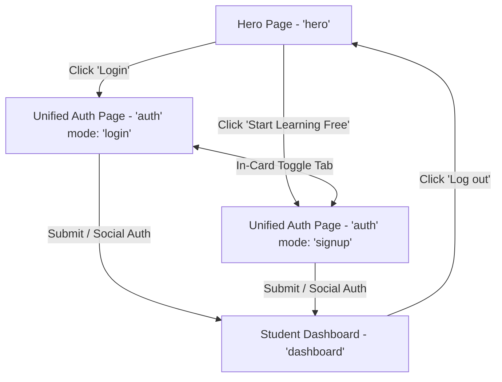

# 🧠 EXPLAINO — Explain What You Know
> **Powered by EXO — Your Voice-Verifying AI Study Companion**

[](https://react.dev/)
[](https://www.typescriptlang.org/)
[](https://vitejs.dev/)
[](https://tailwindcss.com/)
[](https://aws.amazon.com/)

---

## 📖 Table of Contents
1. [Project Overview & Philosophy](#-project-overview--philosophy)
2. [Key Screens & Features Built](#-key-screens--features-built)
3. [The EXO Orb: 3D Mechanics & Mathematical Engine](#-the-exo-orb-3d-mechanics--mathematical-engine)
4. [Application State & Routing Architecture](#-application-state--routing-architecture)
5. [Codebase Directory Structure](#-codebase-directory-structure)
6. [Tech Stack & Dependencies](#-tech-stack--dependencies)
7. [Getting Started (Local Development)](#-getting-started-local-development)
8. [AWS Cloud Deployment Guide](#-aws-cloud-deployment-guide)
9. [Future Roadmap & Backend Integration (Bedrock / AI)](#-future-roadmap--backend-integration)

---

## 🌟 Project Overview & Philosophy

**Explaino** is a next-generation study platform engineered around the **Feynman Technique**: the principle that true mastery of a concept is proven when you can explain it simply in your own words.

Instead of passive flashcards or multiple-choice quizzes, students vocally explain concepts to **EXO** — an empathetic, ethereal AI orb. Explaino analyzes the explanation, identifies hidden conceptual blindspots, builds personalized knowledge gap graphs, and guides the student to mastery.

---

## 🖥️ Key Screens & Features Built

### 1. Hero & Marketing Landing Page (`Hero.tsx`, `Navbar.tsx`, `FeaturesGrid.tsx`)
- **Visual Design**: Ethereal frosted-glass aesthetic using a palette of soft lilacs (`#D8B4FE`), vibrant purples (`#7C5CFF`, `#A855F7`), warm pinks (`#F472B6`), and sky blues (`#38BDF8`).
- **Ambient Stage**: Floating glowing bokeh orbs with subtle floating keyframe animations.
- **Top Navigation Bar**: Minimalist header with the Explaino gradient logo, "How it works" / "Features" links, and a primary **"Login / Sign Up →"** action.
- **Feature Cards Grid (3x2)**:
  1. *Explain Anything*: Speak naturally to EXO via voice input.
  2. *Find Knowledge Gaps*: AI pins down misinterpretations and missed premises.
  3. *Personalized Learning Path*: Dynamically adapts based on detected knowledge gaps.
  4. *Concept Maps*: Interactive visual knowledge graph linking prerequisites and masteries.
  5. *Practice & Reinforce*: Targeted micro-challenges targeting specific weak areas.
  6. *Track Progress*: Real-time confidence scores and topic mastery analytics.

### 2. Unified Auth Experience (`LoginPage.tsx`)
- **Single-Card Architecture**: Seamless toggle between **Login** and **Sign Up** within a single card (`[ Login | Sign Up ]`) without triggering full-page reloads or route disconnections.
- **Interactive Companion & Email Inspection Mode**: Features a live EXO orb inside the page that tracks the user, blinks, and reacts dynamically to form inputs.
- **Magnifying Glass Email Inspection**: When the user enters/focuses the email input field:
  - EXO looks directly towards the input field.
  - A metallic chrome magnifying glass smoothly springs up in front of the orb over the right eye.
  - The right eye is magnified with an intensified neon purple bloom through the lens while the left eye remains visible, matching reference optics.
  - The speech bubble dynamically reflects what the user is typing (`"Reading your email..."`).
  - Clicking out of the field (`onBlur`) smoothly retracts the magnifying glass and returns EXO to normal idle/mouse-tracking companion behaviors.
- **Password Privacy & Sneak-Peek Mode**: When entering the password field:
  - EXO immediately turns its gaze away to the top-left with blushing pink cheeks (*"Shh... Secret password! I'm looking away! 🙈"*).
  - Every 2.2 seconds, EXO playfully sneaks a peek toward the password field, winking with its right eye while peeking with its left eye (*"Just a tiny peek... I promise I didn't see! 🫣"*), before quickly snapping back to looking away.
  - If the user clicks the eye icon to unmask the password, EXO covers both eyes in surprise (*"Password is revealed! Covering my eyes! 🙈"*).
  - Clicking out of the field smoothly restores normal mouse-tracking companion actions.

### 3. Student Dashboard / Home Page (`Dashboard.tsx`)
- **Collapsible Dual-Drawer Layout**:
  - **Left Sidebar**: Expandable/collapsible (`<<` / `>>`) navigation drawer featuring quick links to Dashboard, Subjects, Practice Arena, Knowledge Graph, Analytics, and Settings.
  - **Right Activity Panel**: Expandable/collapsible drawer displaying study streaks (e.g., 5-day streak 🔥), weekly goal progress ring, scheduled live reviews, and recent knowledge gap alerts.
- **Pro Welcome Hero**: Banner greeting the student with an orbiting mini-EXO, daily motivation, and quick "Resume Review" CTA.
- **Interactive Subject Cards**: Grid showcasing active subjects (*Cell Biology*, *Thermodynamics*, *World History*, *Calculus I*) with mastery progress bars, topic counts, and "Continue" buttons.
- **Clean Hero & Concentric Halo**: Centered 3D EXO Orb without distracting thought bubbles or "pro" badges.
- **Scroll-Aware Floating Dock**: Seamlessly adapts when hero banner scrolls out of view.

### 4. Cinematic Skydiving & Free-Fall Loading Screen (`ExoTransitionOverlay.tsx`)
- **Aesthetic**: Recreated based on the high-altitude skydive reference design:
  - **Sky & Clouds**: High-altitude daylight atmospheric sky gradient with soft pastel clouds, ambient light flares, and floating dreamy orbs.
  - **Curved Earth Horizon**: Realistic spherical curve of planet Earth with deep blue oceans, emerald/green continents, atmosphere rim glow, and drifting cloud swirls.
  - **Free-Falling EXO Orb**: Center-stage orb facing directly into the wind at terminal velocity.
  - **Aerodynamic Goggles & Expressions**: Sleek white ski/skydiving goggles with polarized iridescent visor reflection and cute squinting eyes (`< >`) reacting to the high-speed air rush.
  - **Wind & Aerodynamic Elements**: Translucent white slipstream vapor trails swirling upward around both sides of the orb, high-speed vertical wind streak particles, and rapid micro-buffeting vibration against air resistance.
  - **Gradient Motion Graphic Typography**:
    > **"Let's Learn by Explaining"**
    Rendered with continuous fluid gradient shimmer flow, glowing drop bloom, subtitle topic indicator, and an ethereal progress pill capsule.

### 5. Interactive Voice & Concept Chat Workspace (`ChatSession.tsx`)
- **Viewport-Locked Layout (No Double Scrollbars)**:
  - Full-screen `fixed inset-0` architecture with `shrink-0` header and bottom voice dock.
  - Body scroll lock automatically prevents secondary document scrollbars.
  - Single sleek scrollable conversation stream with thin custom scrollbars (`[scrollbar-width:thin]`).
- **Concept Status & Stepper (Right Sidebar)**:
  - Subject tracker (*Photosynthesis 60%*) with 5-step milestone timeline (*Introduction*, *Inputs*, *Process*, *Outputs*, *Importance*).
  - Key points checklist with colored indicator dots.
  - Interactive resource downloads (*Chapter Notes*, *Video Explanation*).
- **Interactive Concept Card**:
  - Full-color vector diagram depicting photosynthesis: Sunlight, Water ($H_2O$), Carbon Dioxide ($CO_2$), Glucose, and Oxygen ($O_2$).
  - Quick action chips (*"Explain in more detail →"*, *"Show real example →"*, *"Generate quiz →"*).
- **Central Voice Hub with Bilateral Reactive Soundwaves**:
  - Floating EXO Orb on a concentric ripple pedestal with an ethereal floating question mark (`?`).
  - **Bilateral dynamic equalizer soundwaves**: magenta/purple waves on the left and cyan/blue waves on the right that actively dance with randomized amplitude pulses when the microphone is toggled.
- **Floating Pill Dock**:
  - Direct keyboard input ("*Type or speak to EXO...*").
  - Iridescent glowing central microphone button.
  - Quick utility actions: Camera video sharing, File upload, and Expanded options.

---


## 🔮 The EXO Orb: 3D Mechanics & Mathematical Engine

The core mascot of Explaino is **EXO** ([`src/components/ExoOrb.tsx`](file:///d:/Explaino/src/components/ExoOrb.tsx)). It combines frosted-glass shader aesthetics with continuous spherical coordinate projections.

### 1. Aesthetic Construction
- **Diffused Frosted Glass**: Built using multi-stop radial gradients layered with top specular arc highlights (`-rotate-12` gloss highlight) and subtle backdrop-blur.
- **Soft Interior Highlights**: Layered cyan-blue (`rgba(96, 165, 250, 0.85)`) on the bottom-left and peach-pink (`rgba(244, 114, 182, 0.85)`) on the right that gently shift with mouse parallax.
- **Neon Eye Bloom**: Signature thick white upward chevrons (`^ ^`) rendered with multi-tiered CSS `drop-shadow` filters creating a vibrant purple-pink bloom (`#FFFFFF` $\to$ `#D8B4FE` $\to$ `#A855F7` $\to$ `#EC4899`).
- **Expressions**: Natural intermittent blinking (160ms scale down on Y axis), occasional winks with glowing pink cheek blush, and joyful squish-and-stretch jumps.

### 2. Seamless Gaze-Based 360° Spherical Revolution
A common problem with CSS 3D rotations is that applying `rotateY(360deg)` to a container flattens the sphere into a 2D disc/coin during rotation. Furthermore, initiating rotation while looking in a direction (e.g., looking right) often causes an abrupt snap back to center. 

**ExoOrb solves this with spherical coordinate mathematics:**

```
                  Top View of Orb Sphere
                          Z+ (Front)
                             ▲
                         0° / Center
                             │
       -90° (Left Horizon) ──┼── +90° (Right Horizon)
                             │
                             ▼
                         Z- (Back)
```

1. **Origin Angle Capture ($\theta_0$)**:
   When the rotation begins, the starting horizontal angle is calculated directly from the active mouse gaze without resetting:
   $$\theta_0 = \arcsin\left(\text{clamp}(\text{mouseX} \cdot 0.45, -0.85, 0.85)\right)$$

2. **Continuous Angular Interpolation**:
   Over the course of the 2.1-second turn with quintic/cubic easing $p \in [0, 1]$, the trajectory smoothly shifts from the initial gaze $\theta_0$ to the active mouse position $\theta_{\text{mouse}}$ while completing a full $2\pi$ radian revolution:
   $$\theta(t) = (1 - p)\theta_0 + p\theta_{\text{mouse}} + 2\pi p$$

3. **Spherical Projection & Foreshortening**:
   - **Horizontal Displacement**: $X = R \cdot \sin(\theta)$
   - **Perspective Foreshortening**: $\text{scaleX} = |\cos(\theta)|$ (the eyes naturally compress as they approach the horizon and expand in the center).
   - **Back-Hemisphere Occlusion**: When $\cos(\theta) < -0.12$, the eyes pass behind the frosted core and fade out naturally:
     $$\text{opacity} = \text{clamp}\left((\cos(\theta) + 0.12) \times 3, 0, 1\right)$$
   - **Zero-Discontinuity Resolution**: At $p = 1$, $\theta = \theta_{\text{mouse}} + 2\pi$, which mathematically produces the exact same position, scale, and opacity as the idle mouse state. The orb transitions seamlessly back to active tracking without snapping or popping.

4. **Decoupled Animation Hierarchy**:
   The vertical jump animation (`@keyframes orbCuteJump`) is applied to an outer container, while mouse orientation and spherical projection are applied to inner layers. This prevents vertical animations from canceling or popping horizontal gaze transforms mid-air.

---

## 🏗️ Application State & Routing Architecture

Explaino uses a streamlined state router inside [`src/App.tsx`](file:///d:/Explaino/src/App.tsx) for snappy transitions:



- **`currentPage`**: `'hero' | 'auth' | 'dashboard'`
- **`authInitialMode`**: `'login' | 'signup'` (controls active tab inside `LoginPage`)
- **`currentUser`**: Tracks active authenticated profile (`name`, `email`)
- **Toast Notifications**: Built-in floating feedback banners with auto-dismissal.

---

## 📁 Codebase Directory Structure

```
d:/Explaino/
├── amplify.yml                 # AWS Amplify Hosting configuration
├── index.html                  # HTML entry point with fonts & meta tags
├── package.json                # Project dependencies and npm scripts
├── postcss.config.js           # PostCSS configuration for Tailwind
├── tailwind.config.js          # Tailwind styling system tokens & themes
├── tsconfig.json               # TypeScript configuration
├── vite.config.ts              # Vite 8 build tool configuration
│
└── src/
    ├── App.tsx                 # Root application state & page router
    ├── main.tsx                # React DOM root mounting
    ├── index.css               # Global styles, keyframe animations, & utilities
    ├── vite-env.d.ts           # Vite type declarations
    │
    └── components/
        ├── BackgroundWaves.tsx # Ambient SVG background gradients & light waves
        ├── Navbar.tsx          # Clean top navigation with CTA
        ├── Hero.tsx            # Hero presentation banner with CTAs
        ├── FeaturesGrid.tsx    # 3x2 feature cards grid matching the PRD
        ├── LoginPage.tsx       # Unified Auth Card (Login <-> Sign Up toggle)
        ├── Dashboard.tsx       # Student dashboard with collapsible drawers
        ├── ExoOrb.tsx          # Core EXO mascot with 3D spherical math
        └── ExoOrb3D.tsx        # Alternative Three.js WebGL implementation
```

---

## 🛠️ Tech Stack & Dependencies

| Category | Technology | Purpose |
|---|---|---|
| **Core Framework** | React 19 (`react`, `react-dom`) | Modern component model & hooks |
| **Language** | TypeScript 5 | Strict static typing and code reliability |
| **Build Tool** | Vite 8 | Instant HMR and high-performance production bundling |
| **Styling** | Tailwind CSS 3 & Custom CSS | Responsive layout, glassmorphism, keyframe animations |
| **Icons** | Lucide React (`lucide-react`) | Clean, modern iconography |
| **3D Rendering** | Three.js (`three`) | Optional WebGL rendering companion |

---

## 🚀 Getting Started (Local Development)

### Prerequisites
- Node.js (v18.0 or newer recommended)
- npm (v9.0 or newer)

### 1. Install Dependencies
```bash
npm install
```

### 2. Run the Development Server
```bash
npm run dev
```
Open [http://127.0.0.1:5173](http://127.0.0.1:5173) in your browser to view the application with Hot Module Replacement (HMR).

### 3. Build for Production
```bash
npm run build
```
This runs `tsc` for type-checking and outputs the optimized static assets into the `dist/` directory.

### 4. Preview the Production Build
```bash
npm run preview
```

---

## ☁️ AWS Cloud Deployment Guide

The project is structured for easy deployment to AWS:

### Option A: AWS Amplify Hosting (Continuous Deployment)
1. Push this repository to GitHub, GitLab, or AWS CodeCommit.
2. In the [AWS Amplify Console](https://console.aws.amazon.com/amplify), choose **New app** > **Host web app**.
3. Connect your repository and select your main branch.
4. Amplify will automatically detect the [`amplify.yml`](file:///d:/Explaino/amplify.yml) file included in the root directory:
   ```yaml
   version: 1
   frontend:
     phases:
       preBuild:
         commands:
           - npm ci
       build:
         commands:
           - npm run build
     artifacts:
       baseDirectory: dist
       files:
         - '**/*'
     cache:
       paths:
         - node_modules/**/*
   ```
5. Click **Save and Deploy**. Your site will be built, provided with an SSL certificate, and served globally through Amazon CloudFront.

### Option B: Amazon S3 + CloudFront (Static Website Hosting)
1. Build the production bundle:
   ```bash
   npm run build
   ```
2. Upload the `dist/` folder contents to your S3 bucket:
   ```bash
   aws s3 sync dist/ s3://<your-bucket-name> --delete
   ```
3. Configure CloudFront with the S3 bucket as the origin and set the default root object to `index.html`. Add an error response rule redirecting 404/403 to `/index.html` (HTTP 200) for SPA routing support.

---

## 🔮 Future Roadmap & Backend Integration

To expand Explaino into a full end-to-end voice learning product as outlined in the PRD:

1. **AWS Bedrock / LLM Pipeline**:
   - Stream voice transcriptions into Claude 3.5 Sonnet or Amazon Titan to evaluate student explanations using the Feynman scoring rubrics.
   - Detect conceptual gaps and calculate confidence ratings (0–100%).
2. **Audio Streaming & Voice Synthesis**:
   - Integrate Amazon Transcribe Streaming (WebSocket) for real-time speech-to-text.
   - Integrate Amazon Polly (or ElevenLabs) for natural, expressive EXO voice replies.
3. **Interactive Knowledge Map**:
   - Connect the Dashboard's "Knowledge Map" view to an interactive force-directed graph (D3.js or Three.js) visualizing unlocked and locked concept nodes.
4. **User Auth & Persistence**:
   - Attach AWS Cognito or Supabase for persistent multi-device student accounts and session history.

---

*Authored for Explaino Core Team & AI Coding Agents.*
